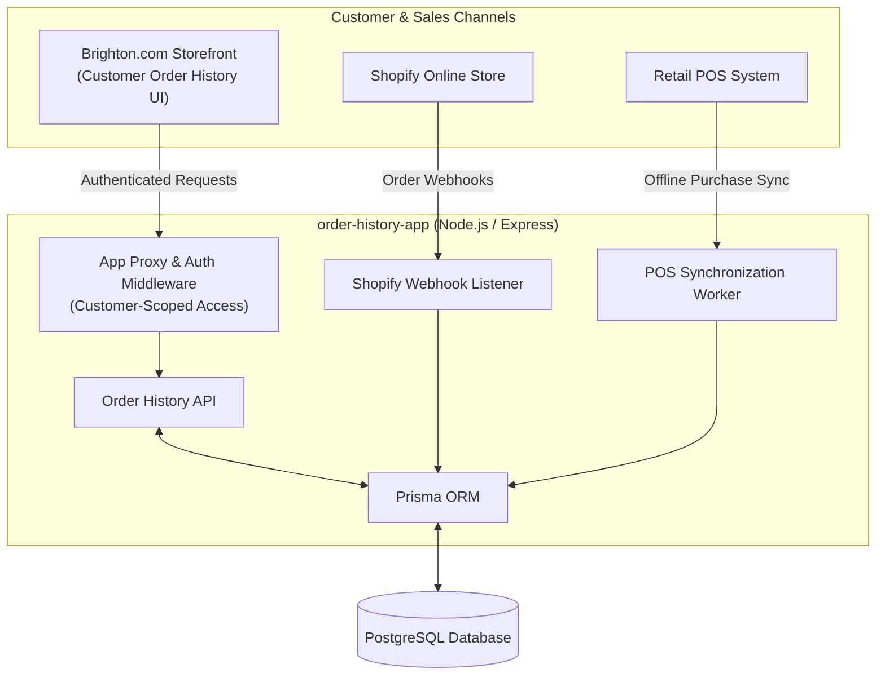

# brighton-order-history
A Node.js based order history service for Brighton.com that unifies online Shopify orders and offline Retail POS purchases into a single customer-facing experience. Built with Express, PostgreSQL, Prisma, and supports Shopify webhooks, POS synchronization, secure customer-scoped access, and near-real-time order updates.

 
 

## Architecture

